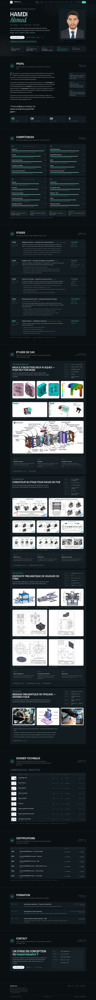

# Portfolio — HAMDI Ahmed

Portfolio d'ingénierie mécanique et d'industrialisation, en **une seule page** :
conception de moules, outillages, convoyeurs, simulation, qualité.

**Site statique, hors connexion, sans dépendance** — HTML, CSS et JavaScript natifs,
polices auto-hébergées. Aucun CDN, aucun framework, aucun build.



---

## Voir le site

Une fois GitHub Pages activé (voir plus bas), le site est en ligne à l'adresse :

```
https://VOTRE-COMPTE.github.io/portfolio-v5/
```

En local, il suffit d'ouvrir `index.html` dans Chrome : tout fonctionne, y compris
sans réseau.

## Ce qu'il contient

| Section | Contenu |
|---|---|
| Hero | nom, méthode de travail, disponibilité (stage de fin d'études, 6 mois, février 2027) |
| 01 Profil | parcours, citation, chiffres clés |
| 02 Compétences | 20 compétences (jauges) et 4 familles d'outils |
| 03 Stages | 5 stages 2021 → 2025 : Techniplast/OneTech, Eleonetech, AD Plast, IAT, GEFTECH |
| 04 Études de cas | D-01 moule d'injection, D-02 convoyeur bi-étage, D-03 dispositif de soudure, D-04 bridage aéronautique |
| 05 Dossier technique | registre de 9 planches (8 plans AD Plast + plan convoyeur), PDF et ZIP |
| 06 Certifications | 6 certifications SOLIDWORKS (CSWE, CSWP, CSWA) avec identifiants vérifiables |
| 07 Formation | Arts et Métiers Paris, ENIB Bizerte, ISET Bizerte |
| 08 Contact | e-mail, téléphone, LinkedIn, CV |

**Médias** : 28 visuels, 2 vidéos MP4 (H.264, issues des GIF), 9 planches PDF, CV et rapports.

## Fonctionnalités

- **Mode jour / mode nuit** : bascule instantanée, mémorisée (`localStorage`), mode initial
  selon l'heure de l'ordinateur.
- **Français / English** : bascule instantanée, 310 paires de textes, langue mémorisée.
- Sommaire actif au défilement, jauge de lecture, menu mobile en tiroir.
- Visionneuse plein écran pour les images et les plans, avec bouton PDF.
- Vidéos : lecture au clic, une seule à la fois.
- Jauges animées, révélations douces, respect de `prefers-reduced-motion`.
- Feuille de style d'impression.
- Responsive vérifié de **320 px à 1920 px**, sans débordement horizontal.

## Structure

```
.
├── index.html              page unique (95 Ko)
├── apercu-page-complete.jpg  aperçu intégral, mode nuit
├── apercu-mode-matin.jpg     aperçu du mode jour
├── .nojekyll               empêche GitHub Pages de traiter le site avec Jekyll
├── LICENSE                 MIT pour le code, contenus protégés
└── assets/
    ├── css/style.css
    ├── js/main.js
    ├── fonts/              6 woff2 (Space Grotesk, Manrope, Instrument Serif, IBM Plex Mono)
    ├── img/                28 visuels
    ├── media/              2 MP4 + 2 affiches
    └── docs/               CV, rapports, dossier technique, 9 plans PDF
```

## Publier sur GitHub Pages

1. Créer un dépôt public, par exemple `portfolio-v5`, **sans** README ni .gitignore.
2. Depuis le dossier du site :

   ```bash
   git init
   git add .
   git commit -m "Portfolio v5 — édition Atelier"
   git branch -M main
   git remote add origin https://github.com/VOTRE-COMPTE/portfolio-v5.git
   git push -u origin main
   ```

3. Sur GitHub : **Settings → Pages → Build and deployment**
   → *Source* : **Deploy from a branch** → *Branch* : **main** / **/(root)** → **Save**.
4. Attendre 1 à 2 minutes. Le site est en ligne à :
   `https://VOTRE-COMPTE.github.io/portfolio-v5/`

Le fichier `.nojekyll` est déjà présent : indispensable pour que GitHub Pages serve
correctement tous les dossiers d'`assets/`.

> Astuce : pour un site à la racine (`https://VOTRE-COMPTE.github.io`), nommer le dépôt
> `VOTRE-COMPTE.github.io`.

## Modifier

- **Couleurs, formes, typographie** : `assets/css/style.css`, blocs `:root` (jour) et
  `:root[data-mode="night"]`.
- **Textes bilingues** : dans `index.html`, chaque texte existe en deux versions,
  `<span class="fr">…</span><span class="en">…</span>`. Modifier les deux.
- **Images** : déposer le fichier dans `assets/img/` puis remplacer le `src`.
- **Documents** : déposer le PDF dans `assets/docs/` puis mettre à jour le lien.

## Compatibilité

| Navigateur | Version |
|---|---|
| Chrome / Edge | 111+ (`color-mix`, variables CSS) |
| Safari | 16.4+ |
| Firefox | 113+ |

## Contact

HAMDI Ahmed — Paris 14ᵉ — <ahmed.hamdi@ensam.eu>
[LinkedIn](https://www.linkedin.com/in/ahmed-hamdi-46b119211/)

---

Code sous licence MIT · Contenus (photos, plans, rapports) tous droits réservés.
